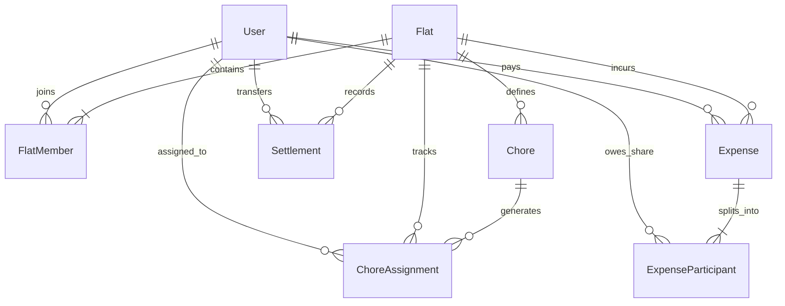

# 🏠 Talabalar Kvartira Boshqaruvi (Tartibli Xonadosh)
### *Smart Student Flatmate & Chore Management Telegram Bot (Phase 1 MVP)*

Talabalar turar joylari (TTJ) va ijarada birga yashovchi talabalar (7–8 kishilik xonalar) uchun navbatchilik (tozalik, chiqindi, suv) va umumiy xarajatlarni (bozorlik, kommunal to'lovlar) avtomatlashtirilgan, shaffof va adolatli boshqarish tizimi.

---

## 🚀 Texnologik Stek

- **Dasturlash tili & Freymvork:** Python 3.11+, [Aiogram 3.x](https://docs.aiogram.dev/) (Modern Asynchronous Telegram Bot Framework)
- **Ma'lumotlar bazasi & ORM:** PostgreSQL 16, [SQLAlchemy 2.0 (asyncio + asyncpg)](https://docs.sqlalchemy.org/)
- **Migratsiyalar:** [Alembic](https://alembic.sqlalchemy.org/)
- **FSM & Kesh:** Redis 7 (Aiogram `RedisStorage`)
- **Vazifalar rejalashtiruvchisi (Cron/Scheduler):** [APScheduler 3.x](https://apscheduler.readthedocs.io/) (AsyncIOScheduler)
- **Konteynerizatsiya:** Docker & Docker Compose

---

## 📂 Loyiha Tuzilmasi (Folder Tree)

```text
tartibli-xonadosh/
├── .env.example              # Muhit o'zgaruvchilari namunasi
├── .gitignore                # Git e'tiborsiz qoldiradigan fayllar
├── Dockerfile                # Production-grade Python 3.11 Docker tasviri
├── docker-compose.yml        # PostgreSQL, Redis va Bot xizmatlari orkestratsiyasi
├── requirements.txt          # Python kutubxonalari ro'yxati
├── alembic.ini               # Alembic migratsiya konfiguratsiyasi
├── README.md                 # To'liq arxitektura va o'rnatish qo'llanmasi
├── alembic/
│   ├── env.py                # Asinxron SQLAlchemy migratsiya muhiti
│   └── versions/             # DB schema versiyalari
├── app/
│   ├── config.py             # Pydantic Settings (Muhit o'zgaruvchilarini yuklash)
│   ├── database/
│   │   ├── base.py           # DeclarativeBase va TimestampMixin
│   │   └── session.py        # Async Engine, SessionMaker, DB Init
│   ├── models/
│   │   ├── user.py           # Telegram User modeli
│   │   ├── flat.py           # Flat (Kvartira) va FlatMember modellari
│   │   ├── chore.py          # Chore va ChoreAssignment modellari
│   │   └── expense.py        # Expense, ExpenseParticipant, Settlement modellari
│   ├── repositories/
│   │   ├── user_repo.py      # Foydalanuvchi ma'lumotlari bilan ishlash
│   │   ├── flat_repo.py      # Kvartira va a'zolik operatsiyalari
│   │   ├── chore_repo.py     # Navbatchilik vazifalari va yozuvlari
│   │   └── expense_repo.py   # Xarajatlar va hisob-kitoblar ombori
│   ├── services/
│   │   ├── onboarding_service.py # Kvartira yaratish, taklif kodi va ulanish
│   │   ├── chore_service.py      # Siklik Round-robin navbatchilik algoritmi
│   │   ├── expense_service.py    # Xarajatlarni taqsimlash va hisoblash
│   │   └── ledger_calculator.py  # Greedy Min-Cash-Flow qarz soddalashtirish algoritmi
│   ├── bot/
│   │   ├── dispatcher.py     # Router va Middleware-larni yig'uvchi Dispatcher
│   │   ├── states/           # FSM holatlari (Kvartira, Navbatchilik, Xarajat)
│   │   ├── middlewares/      # DB Session va Foydalanuvchi Auth Middleware-lari
│   │   ├── keyboards/        # Reply va Inline tugmalar
│   │   └── handlers/         # Bot buyruqlari va hodisa ishlovchilari
│   └── scheduler/
│       └── chore_scheduler.py# Kunlik avtomatik navbatchilik va eslatmalar (Cron)
└── main.py                   # Botni ishga tushirish nuqtasi (Entrypoint)
```

---

## 🗄 Ma'lumotlar Bazasi Modeli (ERD)



---

## 🧠 Algoritmlar va Mantiqiy Yechimlar

### 1. Navbatchilik Tizimi (Cyclic Round-Robin Queue)
Kvartira a'zolari navbati ro'yxat tartibida saqlanadi. Har kuni yarim tunda rejalashtiruvchi (`APScheduler` Cron) navbatni hisoblaydi:
$$\text{Navbatchi Index} = \text{current\_member\_index} \pmod{\text{A'zolar soni}}$$
Vazifa biriktirilgach, index keyingi talabaga oshiriladi. Ertalab 08:30 da va kechqurun 20:30 da navbatchiga bevosita interaktiv inline tugmali (`✅ Bajarildi`, `⏭ O'tkazib yuborish`) eslatma xabari jo'natiladi.

### 2. Xarajatlarni Taqsimlash va Qarzni Soddalashtirish (Greedy Min-Cash-Flow)
Har bir xarid uchun har bir talabaning sof balansi hisoblanadi:
$$\text{Net}(u) = \sum \text{To'lagan summasi} - \sum \text{Uning ulushiga to'g'ri kelgan qarz} + \sum \text{To'langan qarzlar} - \sum \text{Qabul qilingan qarzlar}$$
- **Ijobiy net balance (+):** Haqdor (boshqalar unga pul berishi kerak).
- **Salbiy net balance (-):** Qarzdor (u boshqalarga pul berishi kerak).

**Greedy Min-Cash-Flow algoritmi** o'zaro chigal qarzlarni eng kam tranzaksiyaga qisqartiradi:
- *Misol:* Ali Valiga 30,000 so'm, Vali esa G'aniga 30,000 so'm berishi kerak bo'lsa, tizim buni bitta to'lovga qisqartiradi: **Ali to'g'ridan-to'g'ri G'aniga 30,000 so'm beradi**.

---

## ⚙️ Ishga Tushirish Bo'yicha Qo'llanma

### Variant 1: Docker Compose Orqali (Tavsiya etiladi - 1 daqiqada)

1. **Repozitoriyga o'ting va `.env` faylini tekshiring (avtomatik yaratilgan):**
   ```bash
   cp .env.example .env
   ```

2. **`.env` faylida Bot parametrlari to'ldirilgan:**
   ```env
   BOT_TOKEN=9246474249:AAHRGaZ65FlU3vUpyqv3vT9qlBcLjX-Hej4
   BOT_NAME=TartibliXonadoshBot
   DATABASE_URL=postgresql+asyncpg://postgres:postgres@db:5432/tartibli_db
   TIMEZONE=Asia/Tashkent
   ```

3. **Barcha konteynerlarni (PostgreSQL, Redis, Bot) bir buyruq bilan ishga tushiring:**
   ```bash
   docker compose up --build -d
   ```

4. **Bot loglarini kuzatish:**
   ```bash
   docker compose logs -f bot
   ```


---

### Variant 2: Lokal Muhitda Ishga Tushirish (Python Virtual Environment)

1. **Python 3.11+ o'rnatilganligini tekshiring va virtual muhit yarating:**
   ```bash
   python -m venv .venv
   # Windows:
   .venv\Scripts\activate
   # Linux/macOS:
   source .venv/bin/activate
   ```

2. **Kerakli kutubxonalarni o'rnating:**
   ```bash
   pip install -r requirements.txt
   ```

3. **PostgreSQL va Redis serverlarini ishga tushiring:**
   Lokal PostgreSQL bazangizda `tartibli_xonadosh_db` nomli baza yarating va `.env` faylidagi `DATABASE_URL` hamda `REDIS_URL` parametrlarini moslang.

4. **Botni ishga tushiring:**
   ```bash
   python main.py
   ```

---

## 📱 Bot Foydalanish Ssenariylari

1. **Boshlash (`/start`):**
   - Agar birinchi marta kirsangiz: Yangi kvartira yaratish yoki Taklif kodi orqali qo'shilish.
   - Deep linking: `t.me/Bot?start=join_KV_XXXXX` havolasini bosgan talaba avtomatik kvartiraga qo'shiladi.

2. **Navbatchilik (`📋 Bugungi navbatchilik`):**
   - Bugungi navbatchilar ro'yxati (Oshxona, Musor, Suv) va holati.
   - `[✅ Bajarildi]` bosilganda tizimda qayd qilinadi va xonadoshlar guruhiga bildirishnoma yuboriladi.

3. **Xarajat qo'shish (`➕ Xarajat qo'shish`):**
   - Summa kiritiladi (masalan: `160000`) ➔ Kategoriya tanlanadi (Oziq-ovqat, Kommunal, Suv) ➔ Xarid nomi kiritiladi.
   - Tizim summani xonadagi talabalar soniga teng taqsimlaydi va hisob-kitob daftariga kiritadi.

4. **Kvartira balansi (`📊 Kvartira balansi`):**
   - Har bir talabaning umumiy sarflagan summasi va sof balansi.
   - Minimal qarz to'lash sxemasi: "Vali ➔ Aliga: 40,000 so'm".
   - `[🤝 To'lovni tasdiqlash]` tugmasi orqali qarzni bir zumda yopish.
